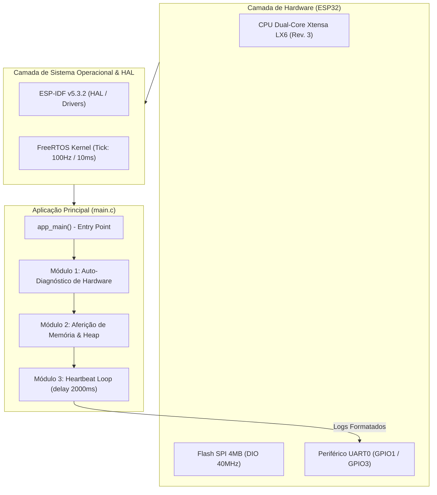
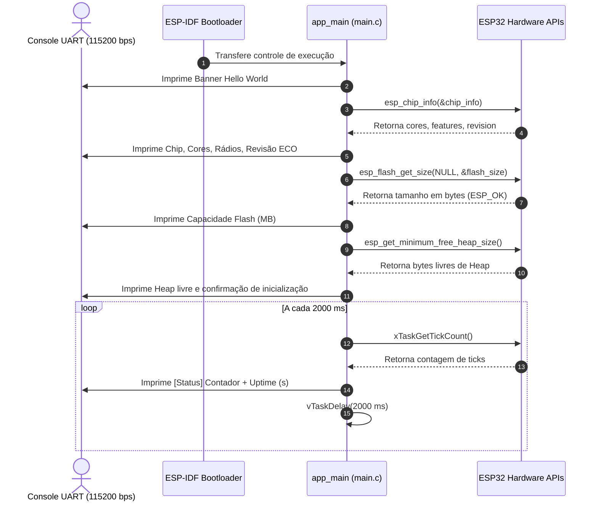

# Documento de Especificação Funcional (FSD)
## Projeto: Teste0 (Firmware ESP32)

---

### Informações do Documento
- **Título do Projeto:** Teste0 - Firmware Base de Diagnóstico e Validação ESP32
- **Identificador do Projeto:** `teste0`
- **Versão do Documento:** 1.0.0
- **Data:** 21 de Outubro de 2026
- **Status:** Aprovado / Baseline
- **Público-Alvo:** Desenvolvedores de Sistemas Embarcados, Engenheiros de Firmware, QA e Arquitetos de Sistemas

---

## 1. Visão Geral e Escopo do Projeto

### 1.1 Objetivo do Projeto
O projeto **Teste0** consiste em um firmware básico desenvolvido para microcontroladores da família **Espressif ESP32**, utilizando o framework oficial **ESP-IDF v5.3.2** sobre o sistema operacional de tempo real **FreeRTOS**.

O firmware atua como camada de verificação, teste de integração de hardware (Board Bring-Up) e diagnósticos fundamentais da plataforma embarcada. Ele valida o funcionamento elétrico e lógico do microcontrolador, inspeciona parâmetros físicos do silício (revisão de hardware, capacidades de rádio, tamanho da memória flash SPI e integridade de heap) e estabelece um serviço cíclico de heartbeat (*uptime monitor*) via interface serial UART.

### 1.2 Escopo
- **Incluso:**
  - Inicialização do sistema operacional FreeRTOS e da pilha de suporte de hardware ESP-IDF.
  - Leitura e telemetria de informações de identificação do chip (arquitetura, núcleos, revisão do silício, periféricos de RF suportados).
  - Consulta e aferição das propriedades da memória Flash SPI externa (capacidade em megabytes e tipo de integração).
  - Monitoramento da integridade de alocação de memória RAM dinâmica (menor patamar de heap livre).
  - Tarefa cíclica com período determinístico (2000 ms) para emissão de sinal de vida (*heartbeat*), contador progressivo e cálculo de uptime do sistema.
  - Comunicação via console UART padrão (115200 bps, 8N1).
- **Fora de Escopo (Fases Futuras):**
  - Associação ativa a redes Wi-Fi ou pareamento Bluetooth clássico/BLE.
  - Implementação de clientes de telemetria em nuvem (MQTT / HTTP / WebSockets).
  - Armazenamento em sistemas de arquivos montados (SPIFFS / LittleFS / FATFS) ou partições NVS de usuário.
  - Atualização de firmware via rede (OTA - *Over-The-Air*).

---

## 2. Arquitetura do Sistema



### 2.1 Especificações da Plataforma de Hardware
| Parâmetro | Especificação Configurada |
| :--- | :--- |
| **Microcontrolador / Target** | Espressif ESP32 (Xtensa Dual-Core 32-bit LX6) |
| **Revisão Mínima de Silício** | Revisão 3.0 (ECO 3) |
| **Memória Flash SPI** | 4 MB (Modo DIO - Dual I/O, Frequência: 40 MHz) |
| **Interface de Comunicação** | UART0 (Baud rate: 115200 bps, 8 bits de dados, sem paridade, 1 stop bit) |
| **Tensão de Operação Típica** | 3.3V DC |

### 2.2 Especificações de Software e Toolchain
| Componente | Versão / Configuração |
| :--- | :--- |
| **Framework Base** | Espressif IoT Development Framework (ESP-IDF) v5.3.2 |
| **Compilador C/C++** | `xtensa-esp32-elf-gcc` (13.2.0_20240530) |
| **Sistema de Build** | CMake 3.16+ & Ninja |
| **Sistema Operacional** | FreeRTOS (SMP Dual-Core habilitado, Tick Rate: 100 Hz / 10 ms por tick) |
| **Tamanho da Stack (Main Task)** | 3584 bytes (`CONFIG_ESP_MAIN_TASK_STACK_SIZE`) |
| **Tabela de Particionamento** | Padrão Single App (`partitions_singleapp.csv`), Offset `0x8000` |

---

## 3. Especificação dos Requisitos

### 3.1 Requisitos Funcionais (RF)

| ID | Requisito Funcional | Descrição |
| :--- | :--- | :--- |
| **RF01** | **Banner de Inicialização** | O sistema deve emitir um cabeçalho descritivo logo após a conclusão da sequência de boot do chip, contendo o nome do projeto (`Teste0`). |
| **RF02** | **Interrogação do Silício** | O firmware deve consultar dinamicamente e imprimir os dados do chip ESP32: nome da arquitetura alvo, quantidade de núcleos de CPU disponíveis, recursos de conectividade de rádio suportados e versão da revisão do silício (Major/Minor/ECO). |
| **RF03** | **Inspeção de Memória Flash** | O firmware deve aferir via API de hardware o tamanho total da memória Flash SPI externa conectada em Megabytes (MB) e seu tipo de integração. |
| **RF04** | **Auditoria de Heap Inicial** | O sistema deve obter o menor patamar de memória RAM dinâmica livre (`minimum free heap size`) e exibir a telemetria antes de iniciar as operações rotineiras. |
| **RF05** | **Loop de Heartbeat Periódico** | O firmware deve manter um loop infinito com período de espera de exatamente 2000 ms, emitindo a cada iteração uma mensagem de status com contador progressivo e o tempo decorrido de operação do sistema (*uptime*) em segundos. |

### 3.2 Requisitos Não-Funcionais (RNF)

| ID | Categoria | Requisito Não-Funcional |
| :--- | :--- | :--- |
| **RNF01** | **Confiabilidade** | A tarefa de loop não deve bloquear a CPU via rotinas ocupadas (*busy-wait*), devendo utilizar suspensão cooperativa do FreeRTOS (`vTaskDelay`) para permitir que o escalonador execute a tarefa Idle e tarefas em segundo plano. |
| **RNF02** | **Desempenho** | O tempo de boot e execução da rotina de auto-diagnóstico inicial não deve ultrapassar 500 ms contados a partir da transição para o `app_main`. |
| **RNF03** | **Portabilidade** | O código-fonte deve aderir ao padrão ANSI C99 e utilizar as APIs oficiais estáveis do ESP-IDF v5.x (evitando chamadas legadas descontinuadas da v4.x). |
| **RNF04** | **Eficiência de Memória** | O consumo de memória RAM alocada para a stack da tarefa principal não deve ultrapassar o limite pré-configurado de 3.5 KB (3584 bytes). |
| **RNF05** | **Determinismo Temporal** | O cálculo do Uptime deve basear-se nos ticks do FreeRTOS convertidos precisamente pela constante `portTICK_PERIOD_MS`, garantindo precisão proporcional à frequência do oscilador RTC/Timer. |
| **RNF06** | **Manutenibilidade** | A estrutura de arquivos do projeto deve seguir rigorosamente as convenções de componentes do ESP-IDF (`CMakeLists.txt` na raiz e na pasta do componente `main`). |

---

## 4. Detalhamento Funcional das Rotinas

### 4.1 Sequência de Inicialização e Diagnóstico de Hardware



#### Descrição das Etapas:
1. **Entrada do Programa (`app_main`):**
   - O ponto de entrada padrão da aplicação é acionado após a conclusão da calibração de clocks e configuração básica de periféricos realizada pelo bootloader do ESP-IDF.
2. **Identificação do Dispositivo:**
   - Chamada à API `esp_chip_info()` para preenchimento da estrutura `esp_chip_info_t`.
   - Avaliação dos bits de status de conectividade:
     - `CHIP_FEATURE_WIFI_BGN`
     - `CHIP_FEATURE_BT`
     - `CHIP_FEATURE_BLE`
     - `CHIP_FEATURE_IEEE802154`
   - Cálculo das revisões de silício `major_rev = chip_info.revision / 100` e `minor_rev = chip_info.revision % 100`.
3. **Inspeção de Memória Flash:**
   - Chamada à API `esp_flash_get_size(NULL, &flash_size)`.
   - Conversão do valor retornado em bytes para Megabytes (`flash_size / (1024 * 1024)`).
   - Identificação quanto à característica de encapsulamento (externa vs embutida).
4. **Inspeção de Memória RAM:**
   - Consulta ao valor instantâneo de segurança através de `esp_get_minimum_free_heap_size()`.

### 4.2 Módulo de Heartbeat e Monitoramento de Uptime

A rotina de repetição periódica executa continuamente enquanto a alimentação do microcontrolador for mantida:
- **Variável de Controle:** Contador incremental inteiro (`int counter`), iniciado em `0` e incrementado em uma unidade a cada ciclo.
- **Cálculo de Uptime:**
  $$\text{Uptime (segundos)} = \frac{\text{xTaskGetTickCount}() \times \text{portTICK\_PERIOD\_MS}}{1000}$$
- **Intervalo:** Suspensão pelo temporizador de software via macro de conversão:
  $$\text{Ticks} = \text{pdMS\_TO\_TICKS}(2000)$$
  Com `CONFIG_FREERTOS_HZ = 100`, 2000 ms equivalem a 200 ticks de FreeRTOS.

---

## 5. Interface Serial e Formato das Mensagens

### 5.1 Parâmetros Físicos da Interface
- **Porta:** UART0 nativa do ESP32.
- **Baud Rate:** 115.200 bps.
- **Formato dos Dados:** 8 bits de dados, sem bit de paridade, 1 stop bit (8-N-1).
- **Controle de Fluxo:** Desabilitado (No Flow Control).

### 5.2 Amostra de Saída no Terminal Serial
Abaixo ilustra-se o padrão exato de saída esperado na interface de console:

```text
========================================
   Hello World - ESP32 Projeto Teste0   
========================================

Chip: esp32
Nucleos de CPU: 2 core(s)
Recursos: WiFi Bluetooth BLE 
Revisao do Silicio: v3.0 (ECO3)
Tamanho da Flash SPI: 4 MB (externa)
Heap livre minimo: 298412 bytes

Sistema iniciado com sucesso e operando normalmente!
----------------------------------------

[Status] Placa ativa e funcionando! Contador: 0 (Uptime: 0 s)
[Status] Placa ativa e funcionando! Contador: 1 (Uptime: 2 s)
[Status] Placa ativa e funcionando! Contador: 2 (Uptime: 4 s)
[Status] Placa ativa e funcionando! Contador: 3 (Uptime: 6 s)
```

---

## 6. Estrutura de Arquivos do Projeto

A organização de diretórios e fontes respeita o modelo canônico do ESP-IDF:

```text
C:\Users\luneque.junior\Projetos_IA\Teste0\
├── CMakeLists.txt              # Configuração global de compilação CMake
├── sdkconfig                   # Definições completas e resolvidas do Kconfig
├── sdkconfig.defaults          # Definições mínimas e padrões customizados do projeto
├── teste0.key                  # Chave privada SSH (ambiente do desenvolvedor)
├── teste0.key.pub              # Chave pública SSH associada
├── FSD.md                      # Este Documento de Especificação Funcional
├── main/
│   ├── CMakeLists.txt          # Declaração do componente principal e fontes C
│   └── main.c                  # Ponto de entrada (app_main) e lógica da aplicação
└── build/                      # Binários gerados, tabela de partição e logs de compilação
```

---

## 7. Gerenciamento de Memória e Particionamento

### 7.1 Tabela de Partição (Single App)
O projeto está configurado para o esquema padrão de aplicação única sem suporte OTA ativo:
- **Arquivo de Tabela:** `partitions_singleapp.csv`
- **Offset Inicial:** `0x8000` (32 KB)
- **Tamanho da Imagem:** Suporta binários de firmware de até 1 MB (com espaço total de 4 MB de Flash física disponível).

### 7.2 Orçamento de Memória RAM (SRAM)
- A stack do `app_main` é dimensionada em **3.584 bytes**.
- A heap livre residual inicial observada gira em torno de **~290 KB a ~300 KB**, deixando capacidade ampla para a introdução de pilhas de rede e drivers adicionais.

---

## 8. Tratamento de Exceções e Resiliência

1. **Falha na Leitura da Memória Flash:**
   - A função `esp_flash_get_size()` é checada contra a constante de sucesso `ESP_OK`. Em caso de erro na comunicação do barramento SPI com a memória flash, o valor não é exibido, evitando comportamentos indefinidos no display.
2. **Watchdog Timers:**
   - O Watchdog de Interrupção (IWDT) e o Watchdog de Tarefa (TWDT) do ESP-IDF permanecem ativos em segundo plano. O uso de `vTaskDelay()` cede o processador à tarefa Idle, assegurando que o TWDT da CPU0/CPU1 seja alimentado sem disparar resets involuntários.
3. **Detector de Brownout (Queda de Tensão):**
   - Habilitado pelo ESP-IDF para reiniciar com segurança o chip caso a alimentação de 3.3V sofra flutuações abaixo dos limites mínimos seguros de operação.

---

## 9. Procedimentos Operacionais: Compilação, Gravação e Monitoramento

Os procedimentos de ciclo de vida do firmware devem ser executados no terminal com o ambiente do ESP-IDF configurado (`export.bat` / `export.ps1`):

### 9.1 Compilar o Projeto
```powershell
idf.py build
```

### 9.2 Gravar na Placa ESP32
Substituir `COMx` pela porta serial identificada no Gerenciador de Dispositivos (ex: `COM3`, `COM4`):
```powershell
idf.py -p COMx flash
```

### 9.3 Monitorar a Execução Serial
Para abrir o terminal serial integrado do ESP-IDF:
```powershell
idf.py -p COMx monitor
```
*(Para encerrar a monitoração, utilizar o atalho de teclado `Ctrl + ]`).*

### 9.4 Ação Combinada (Compilar, Gravar e Monitorar)
```powershell
idf.py -p COMx flash monitor
```

---

## 10. Matriz de Rastreabilidade e Critérios de Aceitação

| Caso de Teste | Requisito Alvo | Procedimento de Teste | Critério de Aceitação / Resultado Esperado |
| :--- | :--- | :--- | :--- |
| **TC-01** | RF01 | Reiniciar a placa via botão EN/RST com o monitor aberto a 115200 bps. | O banner `Hello World - ESP32 Projeto Teste0` deve ser impresso de forma legível. |
| **TC-02** | RF02 | Observar o log de identificação de hardware. | Deve constar `Chip: esp32`, `Nucleos de CPU: 2 core(s)`, rádio e revisão `ECO3`. |
| **TC-03** | RF03 | Verificar relatório de memória Flash. | O log deve reportar `Tamanho da Flash SPI: 4 MB (externa)`. |
| **TC-04** | RF04 | Analisar a linha de telemetria de heap. | Valor de heap livre reportado superior a 200.000 bytes. |
| **TC-05** | RF05, RNF01 | Cronometrar 5 iterações consecutivas da mensagem `[Status]`. | O intervalo médio entre cada linha emitida deve ser de $2.0 \pm 0.1$ segundos, com o Uptime incrementando correspondentemente. |

---

## 11. Roadmap de Evolução Técnica

Para as próximas versões do projeto `Teste0`, sugerem-se as seguintes fases de evolução:
1. **Fase 2 - Conectividade de Rede:**
   - Integração do componente Wi-Fi Station (`esp_wifi`) com reconexão automática e obtenção de IP via DHCP.
   - Sincronização de relógio de tempo real via protocolo SNTP.
2. **Fase 3 - Gestão de Configurações:**
   - Armazenamento de credenciais e parâmetros operacionais na partição NVS (`nvs_flash`).
3. **Fase 4 - Protocolo de Telemetria:**
   - Publicação periódica de métricas de saúde da placa (heap, uptime, RSSI do Wi-Fi) em um broker MQTT via JSON.
4. **Fase 5 - Atualização Segura:**
   - Migração para a tabela de partições de dupla aplicação (`partitions_two_ota.csv`) e habilitação de OTA via HTTPS.
